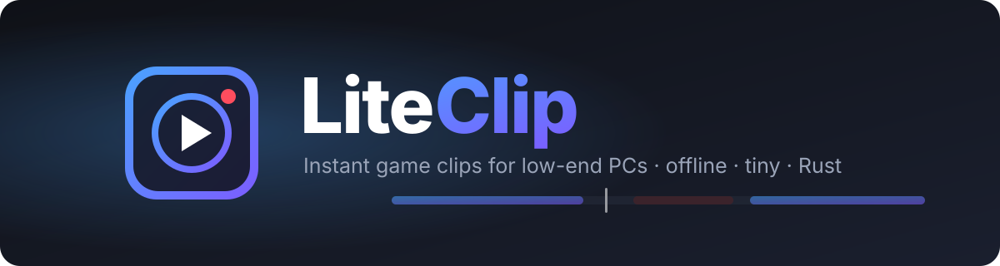

<div align="center">



[](https://github.com/gravy77/LiteClip/actions/workflows/ci.yml)
[](https://github.com/gravy77/LiteClip/releases/latest)
[](LICENSE)

</div>

LiteClip is a replay-buffer screen recorder for Windows. It keeps the last 10 to 300 seconds of your screen in a rolling buffer and saves them as an MP4 when you press a hotkey. It also has a small editor for trimming and cutting clips.

It's meant for low-end machines. Encoding runs on the GPU, saving a clip doesn't re-encode anything, and the app itself is a single native executable of about 4 MB. It doesn't connect to the internet: there are no accounts, uploads, telemetry or update checks.

## Features

- **Replay buffer.** Press `F8` to save the last N seconds. The buffer is already encoded, so saving takes under a second.
- **Hardware encoding.** Uses NVIDIA NVENC, Intel Quick Sync or AMD AMF, picked automatically. Falls back to x264 on the CPU.
- **Audio.** Records system sound and a microphone, each with its own device and volume. Both are mixed into one track.
- **Editor.** Split, cut sections, and trim the start or end. Change speed (0.25× to 4×), volume, resolution and frame rate. A single trim with no other changes is exported without re-encoding.
- **Clip library.** Thumbnails, search, rename, and delete to the Recycle Bin.
- **Global hotkeys.** Work in fullscreen games and while the window is minimized.
- **Recovery.** If capture stops (for example after a display mode change), it restarts automatically. If Desktop Duplication is unavailable, it switches to GDI capture.

On an Intel i5-1035G4 with Iris Plus graphics, recording 1080p at 30 fps used about 17% of one CPU core in the ffmpeg process and about 2% in the UI.

## Installation

LiteClip uses [FFmpeg](https://ffmpeg.org/) for capture and encoding. Install it first:

```powershell
winget install Gyan.FFmpeg.Essentials
```

Then download `LiteClip.exe` from the [releases page](https://github.com/gravy77/LiteClip/releases) and run it. It doesn't need an installer. LiteClip finds FFmpeg on your `PATH`; you can also set its location in Settings.

## Usage

The replay buffer starts when the app opens. Press `F8` to save a clip. Clips are saved to `Videos\LiteClip` by default.

| Key | Action |
|---|---|
| `F8` | Save clip |
| `Alt+F8` | Start or stop the replay buffer |
| `Space` | Play or pause (editor) |
| `S` | Split at the playhead (editor) |
| `D` | Cut or keep the current section (editor) |
| `Left` / `Right` | Seek one second (editor) |

You can change the global hotkeys in Settings.

On slower hardware, lowering the resolution to 720p and the frame rate to 30 fps reduces encoder load and file size.

## Configuration

Everything is set from the Settings tab:

- **Video:** clip length, monitor, capture method, resolution, frame rate, bitrate, encoder, and whether the cursor is shown
- **Audio:** the output device used for system sound, the microphone, a volume for each, and the audio bitrate
- **General:** clips folder, whether the buffer starts on launch, whether the app starts minimized, and the FFmpeg path
- **Clip sound:** a chime, a custom `.wav` file, or off

Files are stored here:

| | Path |
|---|---|
| Settings | `%APPDATA%\LiteClip\settings.json` |
| Replay buffer | `%LOCALAPPDATA%\LiteClip\buffer` |
| Clips | `Videos\LiteClip` (configurable) |

## How it works

FFmpeg captures the screen with Desktop Duplication (`ddagrab`), encodes it with the hardware encoder, and writes 2-second MPEG-TS segments to disk. Only the most recent segments are kept.

System sound (WASAPI loopback) and the microphone are captured in Rust with [cpal](https://github.com/RustAudio/cpal). Both are resampled to 48 kHz and mixed on a clock-driven thread, so the audio stays in sync even when nothing is playing. The mixed audio is piped into FFmpeg.

Saving a clip joins the latest segments and trims them with stream copy (`-c copy`), so nothing is re-encoded.

The editor decodes low-resolution preview frames on demand and exports through a single FFmpeg filter graph. The UI is built with [egui](https://github.com/emilk/egui).

## Building

LiteClip builds with the GNU toolchain and MinGW:

```powershell
winget install Rustlang.Rustup
rustup default stable-x86_64-pc-windows-gnu
winget install BrechtSanders.WinLibs.POSIX.UCRT
.\build.ps1
```

`build.ps1` writes `LiteClip.exe` to the project root and strips local paths from the binary. With the MSVC toolchain, `cargo build --release` is enough.

## Limitations

- Windows only.
- System sound and microphone are mixed into one audio track.
- Captures a whole monitor, not a single window.
- Some exclusive-fullscreen games may capture as black. Borderless mode fixes this.

## Contributing

See [CONTRIBUTING.md](CONTRIBUTING.md).

## License

[MIT](LICENSE)
